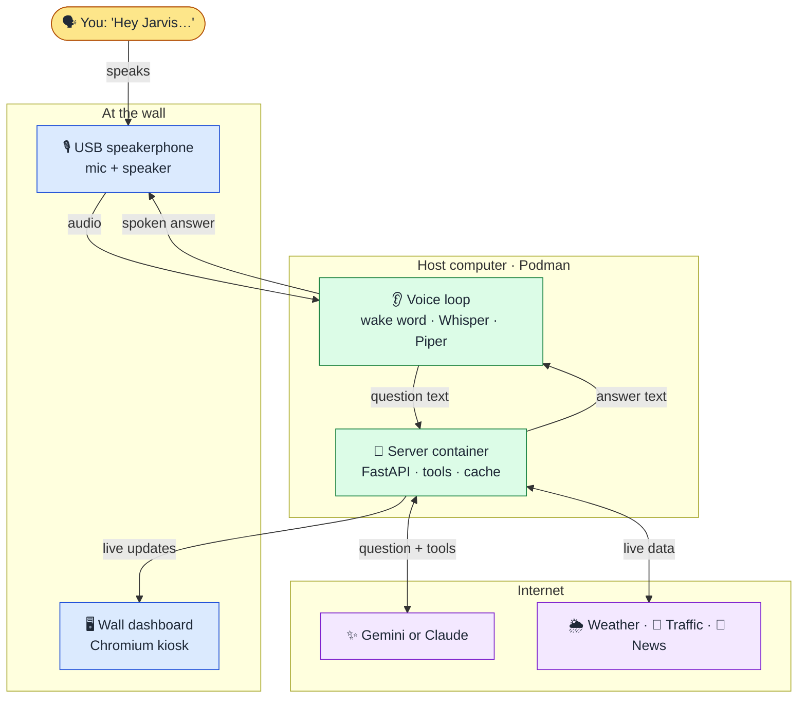

# Jarvis — home wall assistant

A "Hey Jarvis" voice assistant with a wall dashboard for everyday household questions:
weather, live commute times, news headlines, and general questions. The AI behind it is
**Gemini or Claude**, and you can switch between them by changing one line.

## Contents

- [Overview](#overview)
  - [Goals](#goals)
  - [Out of scope](#out-of-scope)
  - [How it works](#how-it-works)
- [About this repository](#about-this-repository)
- [Prerequisites](#prerequisites)
  - [Equipment](#equipment)
  - [Microphone and speaker options](#microphone-and-speaker-options)
  - [Accounts and API keys](#accounts-and-api-keys)
  - [Software](#software)
- [Detailed steps](#detailed-steps)
  - [Step 1: Prepare the host](#step-1-prepare-the-host)
  - [Step 2: Get the code](#step-2-get-the-code)
  - [Step 3: Configure](#step-3-configure)
  - [Step 4: Try it on a Mac (optional)](#step-4-try-it-on-a-mac-optional)
  - [Step 5: Deploy to the wall](#step-5-deploy-to-the-wall)
  - [Step 6: Verify](#step-6-verify)
  - [Step 7: Tune](#step-7-tune)
  - [Step 8: Operate and update](#step-8-operate-and-update)
- [Success criteria](#success-criteria)
- [Rollback](#rollback)
- [Risks](#risks)
- [Switching the AI provider](#switching-the-ai-provider)
- [Privacy](#privacy)
- [Roadmap](#roadmap)

## Overview

Jarvis turns a spare computer and a wall-mounted screen into a family assistant. Say
"Hey Jarvis", ask a question, and it answers out loud while the screen shows the answer
alongside always-on cards for weather, commute times and news.

### Goals

- Answer daily questions by voice: weather, time to school or the gym, latest headlines.
- Answer general questions through Gemini or Claude.
- Use live data for weather, traffic and news, never a guess from the AI model.
- Run unattended: start on its own after a reboot or power cut.
- Keep audio private: nothing is sent anywhere until the wake word is heard.
- Stay cheap: reuse existing hardware where possible.

### Out of scope

- Any access to work systems, clusters or work accounts. This is a home project only.
- Smart-home device control, cameras, and touch input.

### How it works



1. **Wake word.** openWakeWord listens locally for "Hey Jarvis". Nothing leaves the house until then.
2. **Speech to text.** faster-whisper transcribes the question on the device.
3. **Brain.** The server sends the question to Gemini or Claude with three tools, so weather,
   traffic and news always come from live data.
4. **Voice.** The answer is spoken (macOS `say` on a Mac, Piper on Linux).
5. **Dashboard.** The server pushes each step to the wall screen over a WebSocket, so the orb
   listens, thinks and speaks in sync, and the cards refresh every few minutes.

## About this repository

This repository contains everything needed to build and run Jarvis on your own hardware.
It does not host a service: you run it at home, with your own API keys.

| Path | What it does |
|---|---|
| `server/` | FastAPI app: the AI brain, live data sources (weather, traffic, news), the dashboard API and WebSocket. Built as a container. |
| `voice/` | Wake word, speech-to-text and text-to-speech loop. Built as a container on Linux; runs natively on a Mac. |
| `web/index.html` | The wall dashboard: 1080p landscape, no touch needed. |
| `deploy/` | Kiosk service and setup script that make the host boot straight into the dashboard. |
| `compose.yaml` | Podman Compose file that runs the server and voice containers together. |
| `config.example.yaml` | Template for addresses, places, news feeds, AI provider and voice settings. |
| `.env.example` | Template for API keys. |

Your own `config.yaml` and `.env` are listed in `.gitignore`, so addresses and keys stay on
your machine and are never committed.

## Prerequisites

### Equipment

| Item | What to use | Notes |
|---|---|---|
| Host computer | A Linux laptop running **Linux Mint 22.x**, or a mini PC with **Ubuntu Server 24.04** | Can be hidden out of sight, for example on top of a cabinet. Leave a few inches of air around it and keep it away from heat and steam. |
| Wall screen | Any 1080p monitor with HDMI or USB-C input | No touch needed. |
| Video cable | HDMI or USB-C, long enough to reach from the host to the screen | Passive HDMI is usually fine to about 5 m; use an active cable for longer runs. |
| Microphone and speaker | One USB device placed **by the screen**, not on the host | See the options below. A laptop's own mic and speakers are too far away and muffled with the lid shut. |
| USB extension | Active (powered) USB extension, only if the host is more than about 5 m from the screen | A plain USB 2.0 cable is reliable to about 5 m. |
| Network | Wi-Fi or Ethernet with internet access | Needed for the AI, weather, traffic, news and clock sync. |

### Microphone and speaker options

Pick one. All are standard USB audio devices, so no driver is needed on Linux.

| Option | Strengths | Trade-off | Price seen (Nov 2026) |
|---|---|---|---|
| **Jabra Speak2 40** (recommended) | Corded, no battery, 4 mics, about 2.3 m pickup, echo cancellation, small (245 g) | Speakerphone volume, not room-filling music volume | About $145–177 new at Amazon and Walmart; has dropped to about $79 on sale |
| Anker PowerConf S3 | 6 mics, lower price | Built-in battery stays plugged in permanently | About $80–130 |
| ReSpeaker XVF3800 USB 4-mic array, **with case**, plus a small powered speaker | Best far-field pickup (up to 5 m), designed for wake words | Two pieces; plug the speaker into the array's audio-out jack so echo cancellation works | About $56–62 for the array, plus a speaker |

Prices change often; check them before buying.

### Accounts and API keys

Only the key for the AI provider you choose is required.

| What | Key | Notes |
|---|---|---|
| Gemini brain | `GEMINI_API_KEY` | Create in Google AI Studio. To bill a Google AI Pro monthly Cloud credit instead, set `use_vertex: true` and the project in `config.yaml`, then run `gcloud auth application-default login`. |
| Claude brain | `ANTHROPIC_API_KEY` | Create in the Claude Console. API use is billed separately from a Claude chat subscription. |
| Live traffic | `GOOGLE_MAPS_API_KEY` | Google Cloud project with the **Routes API** enabled. Restrict the key to that API. Without it, commute cards show "traffic unavailable". |
| Weather, news | none | Open-Meteo and RSS feeds are free. |

Pricing, free tiers and model names change often; check the providers before relying on them.

### Software

| Software | Version | Notes |
|---|---|---|
| Linux Mint or Ubuntu Server | Mint 22.x or Ubuntu 24.04 | Earlier releases ship a Podman that is too old. |
| Podman | 4.7 or newer | Provides the `podman compose` command. |
| podman-compose, git, curl, alsa-utils | Current distro packages | Installed in Step 1. |
| macOS with Podman and Homebrew | Optional | Only for trying Jarvis on a Mac (Step 4). |

## Detailed steps

### Step 1: Prepare the host

Do this once. Steps 1.1 to 1.3 apply to both hosts; steps 1.4 to 1.8 are for a laptop.

#### 1.1 Check the operating system version

```bash
cat /etc/os-release        # Mint: VERSION="22.x"   Ubuntu: VERSION="24.04 ..."
```

On Linux Mint 21.x, back up your files and upgrade to Mint 22 with Mint's official upgrade
tool before going further.

#### 1.2 Update everything and reboot

```bash
sudo apt update
sudo apt full-upgrade -y
sudo apt autoremove -y
sudo reboot
```

#### 1.3 Install the tools and confirm the Podman version

```bash
sudo apt install -y git podman podman-compose curl alsa-utils
podman --version           # must be 4.7 or newer
```

#### 1.4 Keep the clock correct

If the laptop's clock battery is dead, the time resets after a long power cut. Wrong time
breaks secure connections to the AI and data services. Turn on internet time sync:

```bash
sudo apt install -y systemd-timesyncd     # skip if already installed
sudo timedatectl set-ntp true
sudo systemctl enable systemd-time-wait-sync.service
timedatectl                # expect "System clock synchronized: yes"
```

Then make Wi-Fi connect before anyone logs in: open **Network Connections**, edit the Wi-Fi
network, and on the **General** tab tick **All users may connect to this network**.

#### 1.5 Keep it running with the lid closed

Edit `/etc/systemd/logind.conf` and set:

```
HandleLidSwitch=ignore
HandleLidSwitchExternalPower=ignore
```

In **Power Management**, set the laptop to never suspend on AC power, then reboot.

#### 1.6 Power on after an outage

In the laptop's BIOS, turn on the option that powers it on when AC power is connected
(on ThinkPads usually **Power On with AC Attach**), if the model has one.

#### 1.7 Protect the battery (optional)

A battery kept at 100% in a warm spot can swell. Many ThinkPads can cap charging at about
80% with TLP:

```bash
sudo apt install -y tlp
```

Set `START_CHARGE_THRESH_BAT0=75` and `STOP_CHARGE_THRESH_BAT0=80` in `/etc/tlp.conf`, then
run `sudo tlp start`.

#### 1.8 Check the microphone and speaker

Plug in the USB device, then list sound cards:

```bash
arecord -l                 # note the card name of the USB device
aplay -l
```

The voice loop uses the default sound card, which on a laptop is usually the built-in one.
Until a device setting is added to `config.yaml`, point it at the USB device by adding its
card name to the `voice` service's `environment` in `compose.yaml`, for example
`ALSA_CARD: "Speak2"`. Use the actual name from `arecord -l`.

### Step 2: Get the code

```bash
git clone https://github.com/mrsrilanka/Jarvis.git ~/jarvis
cd ~/jarvis
```

### Step 3: Configure

#### 3.1 Create the local config files

```bash
cp config.example.yaml config.yaml   # addresses, places, feeds, AI provider
cp .env.example .env                 # API keys
```

#### 3.2 Fill in `config.yaml`

- `home`: name for the greeting, address, latitude, longitude, time zone.
- `places`: each destination for commute times. `arrive_by` is optional; when set, Jarvis
  says when to leave.
- `llm.provider`: `gemini` or `claude`.
- `news.feeds`: any RSS feeds.

#### 3.3 Fill in `.env`

Add the keys from [Accounts and API keys](#accounts-and-api-keys).

### Step 4: Try it on a Mac (optional)

Podman on macOS runs containers in a VM that cannot reach the Mac's microphone, so on a Mac
the **server runs in Podman and the voice loop runs natively**.

#### 4.1 Start the server and dashboard

```bash
podman machine init && podman machine start      # first time only
podman compose up -d --build
open http://localhost:8080
```

#### 4.2 Ask a question without a microphone

```bash
curl -s localhost:8080/api/ask -H 'content-type: application/json' \
  -d '{"text":"How long to get to school?"}'
```

#### 4.3 Run the voice loop

```bash
brew install portaudio
python3 -m venv .venv && source .venv/bin/activate
pip install -r voice/requirements.txt
python voice/voice.py          # say "Hey Jarvis"
```

The first voice run downloads the wake-word and Whisper models (a few hundred MB). macOS
asks for microphone permission for the terminal; allow it.

### Step 5: Deploy to the wall

Choose the sub-step that matches the host.

#### 5.1 Mini PC (Ubuntu Server 24.04)

```bash
sudo ./deploy/setup-minipc.sh "$USER"
podman compose --profile voice up -d --build
sudo reboot
```

After the reboot, the containers start on their own and the dashboard opens full-screen.

#### 5.2 Linux Mint laptop

The setup script was written for a host with no desktop. Its kiosk takes over the screen
directly, so Mint's login screen has to be turned off first:

```bash
sudo systemctl disable lightdm        # boot to the kiosk instead of the Mint desktop
sudo ./deploy/setup-minipc.sh "$USER"
podman compose --profile voice up -d --build
```

Make Jarvis wait for the correct time before it starts:

```bash
systemctl --user edit jarvis.service
```

Add these lines in the editor, save, and close:

```
[Service]
ExecStartPre=/bin/sh -c 'until timedatectl show -p NTPSynchronized --value | grep -qx yes; do sleep 2; done'
```

Then reboot:

```bash
sudo reboot
```

### Step 6: Verify

Run these checks after the first boot. [Success criteria](#success-criteria) lists what
"working" means.

```bash
curl -sf http://localhost:8080/healthz && echo OK        # server is up
podman ps                                               # server and voice containers running
timedatectl | grep synchronized                          # clock is synced
podman compose logs -f voice                            # say "Hey Jarvis" and watch it respond
```

### Step 7: Tune

| Problem | Change in `config.yaml` |
|---|---|
| Triggers by accident | Raise `voice.wake_threshold` (for example 0.6) |
| Doesn't hear the speaker | Lower `voice.wake_threshold` (for example 0.4) |
| Cuts the speaker off | Raise `voice.silence_seconds` |
| Slow transcription | `whisper_model: tiny.en` |
| Mishears words | `whisper_model: small.en` |
| Screen too bright at night | Adjust `display.night_start` and `display.night_end` |

Restart after changes: `podman compose --profile voice restart`.

### Step 8: Operate and update

```bash
podman compose logs -f server          # what Jarvis heard and answered
podman compose logs -f voice           # wake word and transcription
arecord -l && aplay -l                 # check the mic and speaker are detected
git pull && podman compose --profile voice up -d --build   # update to the latest version
```

## Success criteria

The deployment is complete when all of these are true:

| # | Criterion | How to check |
|---|---|---|
| 1 | The dashboard opens full-screen on its own after a reboot | Reboot; the screen shows the dashboard with no keyboard input |
| 2 | Weather, commute and news cards show current data | Cards are filled and refresh within `display.refresh_minutes` |
| 3 | "Hey Jarvis" is recognised from normal speaking distance | Five tries from about 2 m succeed at least four times |
| 4 | It rarely triggers by accident | No false triggers during an hour of normal household noise |
| 5 | Spoken answers come from the device by the screen | The answer plays from the USB speaker, not the host |
| 6 | Daily questions return live data | "How long to get to school?" gives a time that matches a maps app |
| 7 | It recovers from a power cut | Unplug for 10 minutes, plug back in; criteria 1 and 2 pass with no manual steps and the clock shows the right time |
| 8 | No secrets in the repository | `git status` never lists `config.yaml` or `.env` |

## Rollback

Use the smallest step that fixes the problem.

### Undo a configuration change

Back up before editing, then restore if needed:

```bash
cp config.yaml config.yaml.bak                    # before editing
cp config.yaml.bak config.yaml                    # to roll back
podman compose --profile voice restart
```

### Go back to an earlier version of Jarvis

```bash
git log --oneline                                 # find the last good commit
git checkout <commit>
podman compose --profile voice up -d --build
```

Return to the latest version with `git checkout main && git pull`, then rebuild.

### Stop Jarvis

```bash
systemctl --user stop jarvis.service
podman compose --profile voice down
```

### Turn off auto-start and the kiosk

```bash
systemctl --user disable jarvis.service
sudo systemctl disable jarvis-kiosk.service
```

### Restore the Linux Mint desktop

```bash
sudo systemctl enable lightdm
sudo reboot
```

### Undo the laptop settings

- Lid and sleep: remove the `HandleLidSwitch` lines from `/etc/systemd/logind.conf` and
  restore the Power Management settings.
- Battery cap: remove the TLP thresholds or run `sudo apt remove tlp`.
- BIOS: turn off the power-on-with-AC option.

### Remove Jarvis completely

```bash
podman compose --profile voice down
podman rmi localhost/jarvis-server:latest localhost/jarvis-voice:latest
sudo rm /etc/systemd/system/jarvis-kiosk.service
rm ~/.config/systemd/user/jarvis.service
rm -rf ~/jarvis
```

Revoke any API keys you no longer need in Google AI Studio, the Claude Console and Google Cloud.

## Risks

| Risk | Impact | Mitigation |
|---|---|---|
| API keys leak | Someone else runs up charges on your account | Keep keys only in `.env`; restrict the Maps key to the Routes API; set spending limits; rotate keys if exposed |
| Unexpected API costs | Monthly bill higher than planned | Use a fast, cheap model; set budget alerts with each provider |
| Clock resets after a power cut | Secure connections fail; blank cards until the clock syncs | Time sync and the wait-for-sync step in Step 1.4 and Step 5.2; replace the clock battery if possible |
| Battery swelling or overheating | Fire or damage risk on a host left plugged in | Ventilation, distance from heat, 80% charge cap, regular visual checks; prefer a mini PC long term |
| Wrong sound device selected | Jarvis does not hear or speaks from the wrong place | Check with `arecord -l` and `aplay -l`; set the card in Step 1.8 |
| False or missed wake words | Annoying interruptions or ignored questions | Tune `voice.wake_threshold`; place the mic away from the TV and range hood |
| Provider or model changes | Errors after a model name is retired | Check model names in `config.yaml` against provider docs; switch provider with one line |
| Internet or provider outage | No answers or live data | Dashboard keeps the last cached data; switch AI provider if one is down |
| Operating system upgrade breaks something | Kiosk or containers fail to start | Upgrade when you have time to test; use [Rollback](#rollback) |
| Privacy expectations | Household members unsure what is recorded | Explain the wake word and what is sent; see [Privacy](#privacy) |

## Switching the AI provider

Change `llm.provider` to `gemini` or `claude` in `config.yaml`, then restart the server:

```bash
podman compose restart server
```

Both providers get the same tools and the same spoken-reply instructions in `server/llm.py`.

## Privacy

- Audio is recorded only after the wake word, and transcription happens on the device.
- Only the transcribed question text is sent to Gemini or Claude.
- Addresses live only in the local `config.yaml`.

## Roadmap

- [ ] Web search tool for current questions beyond weather, traffic and news
- [ ] Google Calendar card ("drop-off in 20 minutes, leave now")
- [ ] Morning briefing on a schedule
- [x] Hardware list
- [ ] Wall-mount notes
- [ ] `voice.input_device` and `voice.output_device` settings in `config.yaml`
- [ ] Dedicated Linux Mint setup script
